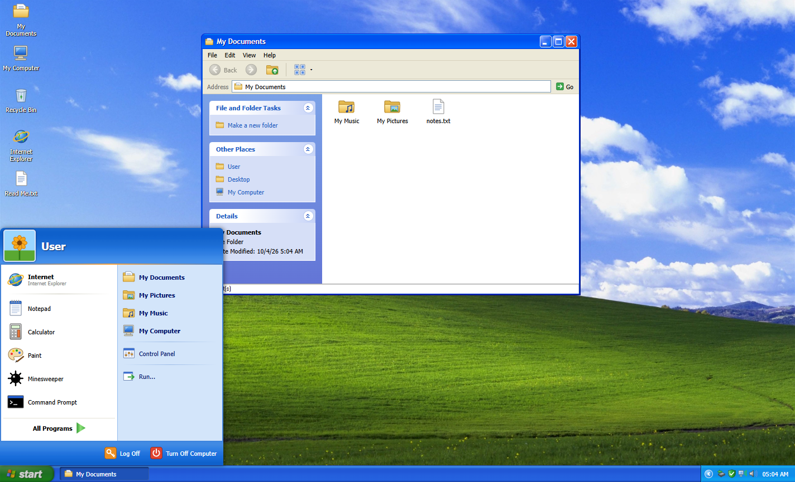
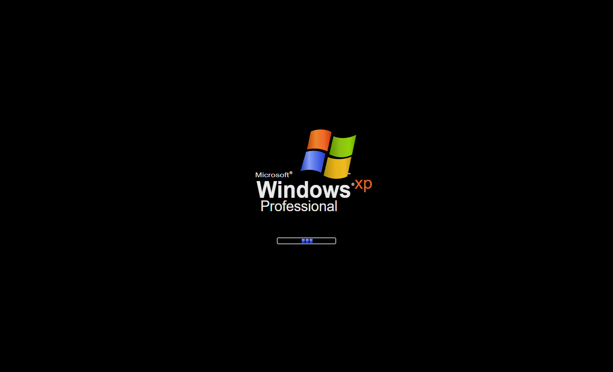
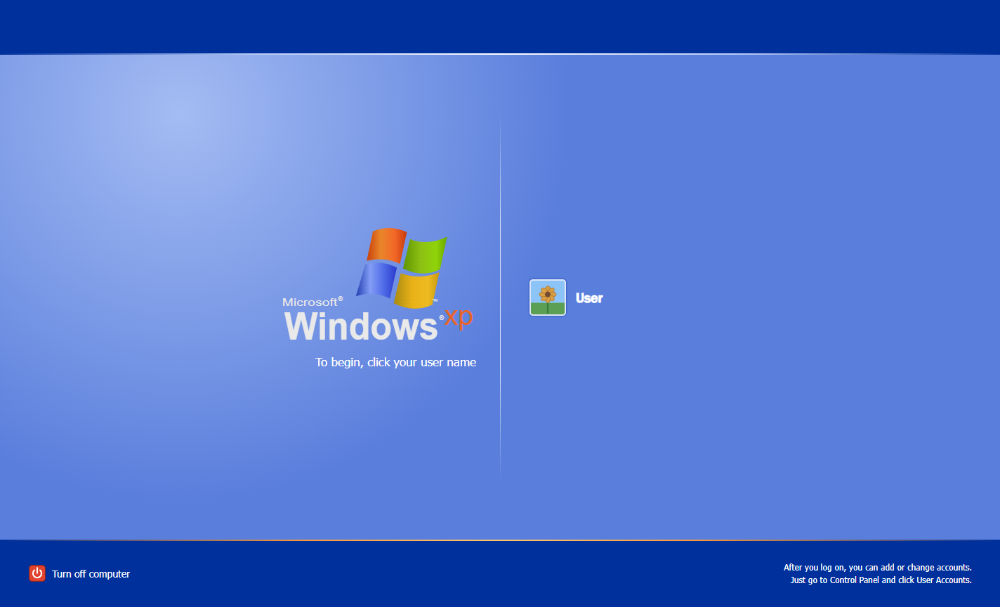
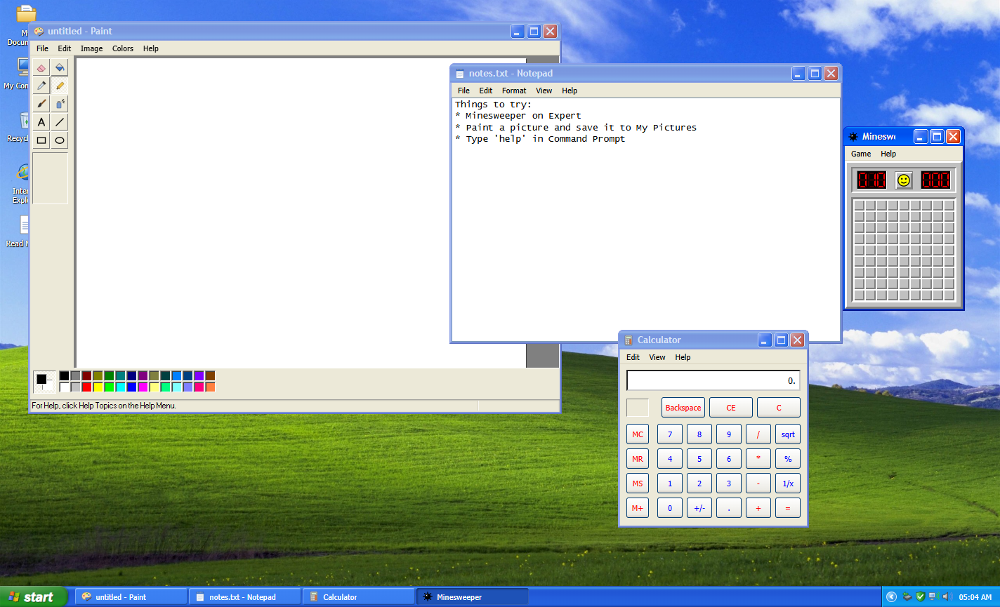
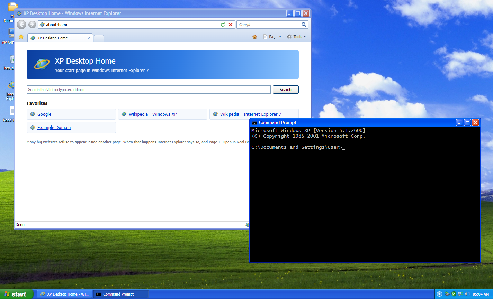
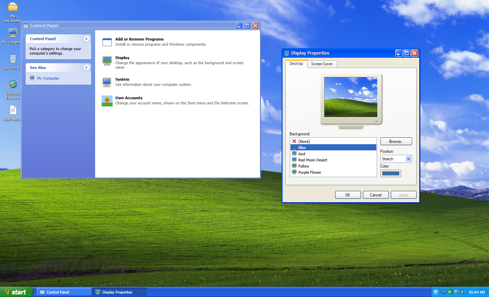

# XP Desktop

Tarayıcıda çalışan bir Windows XP (Luna) masaüstü. Açılış ekranıyla başlar, Hoş Geldiniz ekranından oturum açılır. Masaüstündeki pencereler sürüklenir, boyutlandırılır, simge durumuna küçültülür ve ekranı kaplar. Uygulamalar gerçekten çalışır ve tarayıcıda saklanan ortak bir dosya sistemini kullanır.

React 19, TypeScript, Bun, [xp.css](https://botoxparty.github.io/XP.css/), react-rnd ve zustand ile yazıldı. Arka uç yok: sunucu yalnızca uygulama paketini, isteğe bağlı duvar kâğıdını ve ses dosyalarını sunar.



| Açılış                                                                  | Hoş Geldiniz                                                        |
| ----------------------------------------------------------------------- | ------------------------------------------------------------------- |
|                              |                   |
| **Paint, Notepad, Hesap Makinesi, Mayın Tarlası**                       | **Internet Explorer ve Komut İstemi**                               |
|                                |  |
| **Denetim Masası ve Görüntü Özellikleri**                               |                                                                     |
|  |                                                                     |

> Arayüz, gerçek XP gibi İngilizcedir. Bu belgede Türkçe adlarının yanında arayüzdeki İngilizce adları da verildi.

## Özellikler

**Oturum**

- İlerleme çubuklu açılış ekranı ve ardından Hoş Geldiniz ekranı. Oturum açmak için kullanıcı kutucuğuna tıklayın.
- Oturumu Kapat penceresi (Switch User / Log Off) ve Bilgisayarı Kapat penceresi (Stand By / Turn Off / Restart). Pencere açıkken arkadaki masaüstü XP'deki gibi griye döner.
- Açılış, oturum açma, oturum kapatma ve kapanış sesleri Web Audio ile üretilir. İsterseniz kendi ses dosyalarınızı koyabilirsiniz.
- Görüntü Özellikleri'nde ayarlanan bekleme süresinden sonra ekran koruyucu açılır: Blank, Marquee veya Starfield.

**Kabuk**

- Masaüstü simgeleri bir ızgaraya oturur:
  - fareyle alan seçme ve sürükleyip taşıma,
  - F2 ile yeniden adlandırma,
  - sağ tık menüsü: New ▸ Folder / Text Document, Arrange Icons By, Refresh, Properties.
- Pencereler:
  - sürükleme ve boyutlandırma,
  - başlık çubuğuna çift tıklayınca ekranı kaplama,
  - görev çubuğuna küçültme ve Alt+F4 ile kapatma,
  - başlık simgesinde ve görev çubuğu düğmesinin sağ tık menüsünde pencere menüsü.
- Görev çubuğu: başlat düğmesi, görev düğmeleri ve bildirim alanı. Bildirim alanında şunlar bulunur:
  - gizli simgeleri açan "<" düğmesi,
  - Donanımı Güvenle Kaldır, Güvenlik Merkezi ve ağ simgeleri,
  - tıklayınca sesi kapatıp açan ses simgesi,
  - saat.
- Başlat menüsü:
  - en son kullanılan programları öne alan sık kullanılanlar listesi,
  - All Programs (Accessories, Games),
  - Belgelerim, Resimlerim, Müziğim ve Bilgisayarım,
  - Denetim Masası ve Çalıştır.
- Geri Dönüşüm Kutusu: silinen öğeler geri yüklenebilir veya kalıcı olarak silinebilir.

**Uygulamalar**

| Uygulama            | Neler çalışıyor                                                                                                                                                                            |
| ------------------- | ------------------------------------------------------------------------------------------------------------------------------------------------------------------------------------------ |
| Windows Gezgini     | Görev bölmesi, Geri/İleri/Yukarı, adres çubuğu, Simgeler / Liste / Ayrıntılar görünümleri, kes-kopyala-yapıştır, yeniden adlandır, sil                                                     |
| Notepad             | XP tarzı dosya penceresiyle Aç / Kaydet / Farklı Kaydet, Word Wrap, Saat/Tarih (F5), kaydedilmemiş değişiklik uyarısı                                                                      |
| Hesap Makinesi      | Bellek tuşları, %, karekök ve 1/x ile standart mod                                                                                                                                         |
| Mayın Tarlası       | Beginner / Intermediate / Expert / Custom seviyeleri, bayrak ve ? işaretleri, en iyi süreler, F2 ile yeni oyun                                                                             |
| Paint               | Kalem, fırça, sprey, silgi, doldurma, renk seçici, metin, çizgi, dikdörtgen ve elips araçları; renk paleti; PNG olarak Resimlerim'e kaydetme                                               |
| Internet Explorer 7 | Sekmeler, geçmiş, Giriş, Yenile/Durdur, arama kutusu, sık kullanılanlar. Çerçeve içinde açılmayı reddeden siteler için "görüntülenemiyor" sayfası ve "Open in Real Browser Tab" bağlantısı |
| Komut İstemi        | Ortak dosya sistemi üzerinde `CD DIR TYPE MD RD DEL ECHO CLS DATE TIME VER START HELP EXIT` komutları, ↑/↓ ile komut geçmişi                                                               |
| Görüntü Özellikleri | Canlı önizleme ile duvar kâğıdı (hazır, Resimlerim'den ya da yüklenen), konum, arka plan rengi, ekran koruyucu ve bekleme süresi                                                           |
| Denetim Masası      | Görüntü, Sistem, Kullanıcı Hesapları (kullanıcı adını değiştirir), Program Ekle/Kaldır                                                                                                     |

**Klavye**

- Ctrl+Esc başlat menüsünü açar, Alt+F4 etkin pencereyi kapatır, Esc menüleri ve iletişim kutularını kapatır.
- Dosyalarda Enter, Del, F2 ve Ctrl+A / C / X / V çalışır.
- Gezgin'de Backspace bir üst klasöre çıkar.

## Docker ile çalıştırma

```bash
docker compose up -d --build
```

Uygulama 3000 numaralı portu dinler. Nginx Proxy Manager'da yönlendirme adresi olarak `http://<sunucu>:3000` girin.

[docker-compose.yml](docker-compose.yml) içindeki `SITE_URL` değerini sitenin herkese açık adresiyle değiştirin (sonda `/` olmadan). Canonical bağlantısı ile Open Graph `og:url` ve `og:image` adresleri bundan üretilir; paylaşım önizlemeleri mutlak adres ister.

Ana makinede port açmak istemiyorsanız container'ı NPM ile aynı Docker ağına alın:

1. [docker-compose.yml](docker-compose.yml) içindeki `networks` bloğunun yorumunu kaldırın.
2. `ports` bölümünü silin.
3. NPM'de yönlendirme adresini `http://xp-desktop:3000` yapın.

İmaj hakkında:

- `oven/bun:1.4-alpine` tabanlıdır ve yaklaşık 150 MB tutar.
- root olmayan bir kullanıcıyla çalışır ve bir health check içerir.
- Bun, uygulamayı container açılırken paketleyip küçültür.
- Hash'li dosyalar `Cache-Control: immutable` başlığıyla sunulur.

## Geliştirme

[Bun](https://bun.sh) 1.4 veya üstü gerekir.

```bash
bun install
bun run dev        # http://localhost:3000, anında yenilemeli
bun test           # dosya sistemi, Hesap Makinesi, Mayın Tarlası, Komut İstemi, simge ızgarası
bun run typecheck
bun run lint       # ESLint (typescript-eslint + react-hooks) ve Prettier kontrolü
bun run format     # Prettier ile biçimlendir (printWidth 120)
bun run build      # dist/ içine statik paket
bun start          # production sunucusu (Docker imajıyla aynı)
```

`dist/` herhangi bir statik sunucuda, alt klasörde de çalışır. Tek fark: `public/wallpapers/` içinde fotoğraf yoksa Bliss yerine düz renk görünür (çizilmiş tepe yalnızca sunucuda). `main`'e her push [GitHub Pages](https://mihrimatrix.github.io/xp-clone-react/)'e yayınlanır ([pages.yml](.github/workflows/pages.yml)). Paylaşım önizlemeleri için `SITE_URL=https://alan.adi bun run build` ile derleyin.

## Kendi duvar kâğıdınız ve sesleriniz

Sunucu bu dosyaları `public/` klasöründen okur, yeniden derleme gerekmez:

- **Duvar kâğıdı:** `public/wallpapers/bliss.jpg` (veya .png / .bmp / .webp) Bliss duvar kâğıdı olarak kullanılır. Dosya yoksa çizilmiş bir benzeri gösterilir.
- **Telif uyarısı:** Orijinal Bliss fotoğrafının telif hakkı Microsoft'a aittir. Yalnızca kendi kopyanızı kullanın. Bu dosyayı herkese açık depolara ve hakkınız olmayan herkese açık yayınlara koymayın.
- **Sesler:** `public/sounds/<ad>.wav|mp3|ogg` dosyası ilgili üretilmiş sesin yerine geçer. Ses adları: `startup logon logoff shutdown error exclamation ding notify recycle navigate`.

## Proje yapısı

```
src/
  index.ts          Bun sunucusu: HTML paketi, /wallpapers/bliss, /sounds/*
  App.tsx           masaüstü, pencere katmanı, görev çubuğu, iletişim kutuları
  components/shell/ Window, Taskbar, StartMenu, Desktop, Session (açılış/Hoş Geldiniz/oturum kapatma), menüler
  components/apps/  uygulama bileşenleri (Notepad.tsx, Paint.tsx, ...)
  lib/              React'siz mantık ve testleri (calculator, cmd, minesweeper, paint, grid, sound, files) + registry.ts
  styles/           global.css ve uygulama başına bir CSS dosyası
  store/            zustand store'ları: fs (sanal dosya sistemi), windows, settings, hepsi kalıcı
  assets/icons/     elle çizilmiş SVG simgeler (styles/global.css içindeki .ico-<ad> sınıfları)
```

Durum `localStorage`'da (dosyalar, ayarlar) ve `sessionStorage`'da (açık pencereler) tutulur. Makineyi sıfırlamak için sitenin verilerini temizleyin.

## Nasıl çalışır

**Sunucu ve paketleme.** `src/index.ts` bir `Bun.serve` sunucusudur. `index.html` dosyasını doğrudan import eder ve Bun, sayfanın kullandığı TSX ve CSS dosyalarını istek geldiğinde paketler (geliştirmede anında yenilemeyle). xp.css içinde Bun'ın katı CSS ayrıştırıcısının reddettiği birkaç seçici var. `xp-css-fix.ts` eklentisi bu seçicileri dosya yüklenirken düzeltir. Eklenti geliştirme sunucusu için `bunfig.toml` ile, `dist` paketi için `build.ts` (Bun.build API) ile bağlanır.

**SEO ve Open Graph.** Meta etiketleri `index.html` içindedir; mutlak adres gereken yerlerde `%SITE_URL%` yer tutucusu bulunur. Paket gizli `/_index` yolunda sunulur, sayfa istekleri onu çekip yer tutucuyu doldurur. `build.ts` aynı işi `dist/index.html` için yapar. Paylaşım görseli `public/og.png` (1200×630) uygulamanın kendi ekran görüntüsüdür.

**Durum (zustand store'ları).**

- `useFs`, sanal diskin tamamıdır: `Record<id, FsNode>` biçiminde düz bir tablo. Her düğüm `parentId` tutar. Yollar, alt öğeler ve ağaç bu bağlardan türetilir. Ad karşılaştırması Windows'taki gibi büyük/küçük harf duyarsızdır.
  - Her işlem (oluşturma, taşıma, silme, geri yükleme…) tablonun bir kopyası üzerinde çalışır ve sonucu tek bir `set` ile yazar. Bu sayede yarıda atılan bir hata diski bozmaz. Arayüz hatayı yakalar ve XP mesaj kutusu olarak gösterir.
  - Silinen öğe `BIN` altına taşınır ve eski yerini `origParentId`'de saklar. `SYSTEM` içindeki klasörler "Access is denied" verir.
- `useWindows`, açık pencerelerin konumunu, boyutunu, z-sırasını, durumunu (normal/min/max) ve oturum aşamasını (`phase`) tutar.
  - Odak, küçültme ve büyütme hep `show()` üzerinden geçer. Etkin pencere hesaplanır: küçültülmemiş pencerelerin en üstteki.
  - Kaydedilmemiş işi olan uygulamalar `useCloseGuard` ile kapanmayı geciktirir. Pencereler `sessionStorage`'da tutulduğu için sekme kapanınca kaybolur.
- `useSettings`; duvar kâğıdını, ekran koruyucuyu, sesi, masaüstü simge konumlarını ve Mayın Tarlası rekorlarını `localStorage`'da tutar. zustand'ın varsayılan sığ birleştirmesi sayesinde sonradan eklenen ayarlar, eski kayıtlı veride varsayılan değerlerine düşer.

**Oturum.** Aşamalar `boot → login → desktop → logoff/shutdown/restart → …` sırasıyla ilerler. `Session.tsx` masaüstü dışındaki her ekranı çizer, ilgili sesi çalar ve zamanlayıcıyla sonraki aşamaya geçer. Zamanlayıcı React 19'un `useEffectEvent`'iyle yazıldı: effect yeniden çalışmadan her zaman en güncel callback'i çağırır.

**Pencereler.** Her pencere bir `react-rnd` öğesidir ve `memo` ile sarılıdır. Bir pencereyi taşımak yalnızca o pencerenin `Win` nesnesini değiştirir, diğerleri yeniden çizilmez. Uygulamalar şu hook'ları kullanır:

- `useTitle`: başlık çubuğu ve görev çubuğu metni,
- `useCloseGuard`: "Değişiklikleri kaydetmek istiyor musunuz?",
- `useFitWindow`: pencereyi içeriğe göre boyutlama (Hesap Makinesi, Mayın Tarlası).

**Kabuk.**

- Masaüstü simgeleri 75 px'lik bir ızgaradadır. `grid.ts` içindeki saf fonksiyonlar her simgeyi kayıtlı hücresine ya da ilk boş hücreye yerleştirir. Bir simge dolu hücreye bırakılırsa en yakın boş hücreyi halka halka arar.
- `files.tsx`, masaüstü ve Gezgin için ortak dosya katmanıdır: açma, pano, silme/geri dönüşüm, sağ tık menüsü ve klavye kısayolları.
- Sürükle-bırak yerel HTML5 olaylarıyla yapılır. Bütün pencereler tek bir belgede olduğu için sürüklenen id'ler bir modül değişkeninde tutulur.
- Sağ tık menüleri ve iletişim kutuları (`msgBox`, `confirmBox`, `formBox`, `fileDialog`) aynı kalıbı kullanır. Fonksiyon bir store'a kayıt ekler ve bir Promise döner. Ekrandaki tek "Host" bileşeni bu kaydı çizer ve kullanıcının seçimiyle Promise'i çözer. Böylece uygulama kodu `if (await confirmBox(...))` diye yazabilir.

**Uygulamalar.** `apps/registry.ts` her uygulamanın id'sini (Çalıştır komutu da budur), başlığını, simgesini, bileşenini, boyutunu ve açtığı uzantıları listeler. `useWindows.open(appId, props)` bir pencere kaydı oluşturur. Bileşen pencerenin tamamını `{ win }` olarak alır.

- **Saf mantık modülleri:** Hesap Makinesi, Mayın Tarlası, Komut İstemi ve Paint'te mantık React'ten ayrı, saf modüllerdedir (`logic.ts`, `shell.ts`, `tools.ts`). Bu yüzden `bun test` onları tarayıcı olmadan doğrular.
  - **Hesap Makinesi:** `press(state, key)` bir durum makinesidir.
  - **Mayın Tarlası:** İlk tıklama her zaman güvenlidir, çünkü mayınlar ilk açılışta yerleştirilir.
  - **Komut İstemi:** `exec(line, cwd)` komutu sanal disk üzerinde çalıştırır. Sonuç olarak çıktı satırlarını ve arayüze talimatları döner.
- **Paint:** Ana tuval ile şeffaf bir önizleme tuvali kullanır. Kalem ve dolgu araçları kenarları yumuşatılmamış pikseller basar (Bresenham çizgi, satır tabanlı flood fill). Dosyalar sanal diske PNG data URL olarak yazılır.
- **Internet Explorer 7:** Her sekmenin kendi geçmişi ve yükleme durumu vardır. Siteler sandbox'lı bir `<iframe>` içinde açılır. 15 saniyede yüklenmeyen sayfa hata sayfasına düşer. `about:home` ile `about:tabs` React bileşenleridir.

**Sesler.** `sound.ts` önce `public/sounds/` altındaki dosyayı dener. Dosya yoksa (sunucu 204 döner) özgün tonları Web Audio osilatörleriyle sentezler.

**Stiller.** Temel XP görünümü xp.css'ten gelir. `styles/global.css` yalnızca xp.css'in kapsamadıklarını ekler: kabuk, menüler, iletişim kutuları ve `.ico-*` simge sınıfları. Her uygulama `styles/` altındaki kendi CSS dosyasını, kendi sınıf önekiyle import eder. Kendi çizilen butonlar `.flat` sınıfıyla xp.css buton stilinden çıkar.

**Kod kuralları.** ESLint (typescript-eslint + react-hooks 7) ve Prettier (`printWidth: 120`) kullanılır. Kontrol için `bun run lint` yeterlidir. Projede iki tuzak var:

- `useEffect` gövdeleri her zaman süslü parantezle yazılır. zustand persist'in `set`'i ve Chrome'un `scrollIntoView`'u Promise döner. Effect bunu döndürürse React onu bozuk bir cleanup sanıp hata fırlatır.
- typescript-eslint henüz TS 7'yi desteklemiyor. Bu yüzden `typescript` paketi TS 6 API'sine (`@typescript/typescript6`) yönlendirilmiş durumda. `tsc` ise `@typescript/native` üzerinden TS 7 ile çalışır.

## Yeni uygulama ekleme

1. `src/components/apps/<Ad>.tsx` dosyasını oluşturun (stili varsa `src/styles/<ad>.css`, saf mantığı varsa `src/lib/<ad>.ts`). Dosya `({ win }: AppProps) => JSX` biçiminde bir bileşeni default export etmeli.
2. `src/lib/registry.ts` içindeki `list` dizisine bir kayıt ekleyin:
   - `id` aynı zamanda Çalıştır ve Komut İstemi'ndeki komut adıdır.
   - `opens`, dosya uzantılarını bu uygulamaya bağlar. Dosya simgeleri de buradan belirlenir.
3. İsteğe bağlı:
   - bir simge: `src/assets/icons/<ad>.svg` dosyası ve `src/styles/global.css` içine bir `.ico-<ad>` satırı,
   - başlat menüsünde bir yer: `src/components/shell/StartMenu.tsx` içindeki `PROGRAMS` listesi.

## Yasal not

Bu proje eğlence ve nostalji için yapılmış bir hayran çalışmasıdır. Microsoft ile bağlantısı yoktur ve Microsoft tarafından onaylanmamıştır. Windows, Windows XP ve Windows logosu Microsoft Corporation'ın ticari markalarıdır. Buradaki tüm simgeler ve açılış logosu SVG olarak sıfırdan çizildi; projede Microsoft'a ait dosya yoktur.
